# PlanKraft

Editor desktop de **plantas baixas** para Windows, macOS e Linux — simples como o Figma, pensado para desenho arquitetônico residencial.
Desenhe paredes, portas e janelas, mobilie com blocos, gere cotas automáticas, trace sobre a foto de uma planta existente,
exporte **PDF vetorial em escala**, veja a **maquete 3D** e gere plantas a partir de uma descrição em português — inclusive **offline e de graça**.

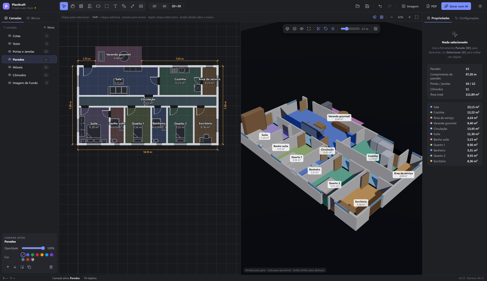

## Destaques

| | |
|---|---|
| **Desenho** — paredes (linha, polilinha ou retângulo) com ímã e trava de 45°, portas e janelas que se encaixam na parede, cômodos com área útil calculada, textos e medidas. | 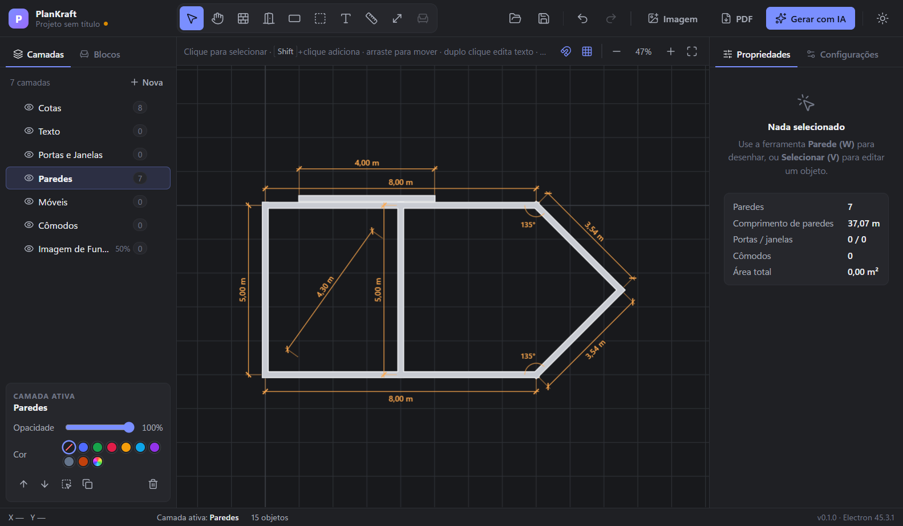 |
| **Cotas automáticas** — toda parede ganha cota (inclusive diagonais, com texto sempre legível), no lado externo, escalonadas quando se sobrepõem, com ângulos entre paredes. | |
| **Blocos** — mais de 75 símbolos vetoriais (sala, quarto, cozinha, banheiro, escritório, garagem e lazer, jardim, escada, estrutura) **modelos 3D detalhados** para 40 deles (Kenney, CC0 — ver [docs/CREDITOS.md](docs/CREDITOS.md)) e **modelos 3D próprios** (.glb) que viram blocos e aparecem em volume na maquete, arrastar para o desenho, encaixe automático na parede, girar/espelhar/redimensionar e blocos personalizados que atualizam todas as cópias. | 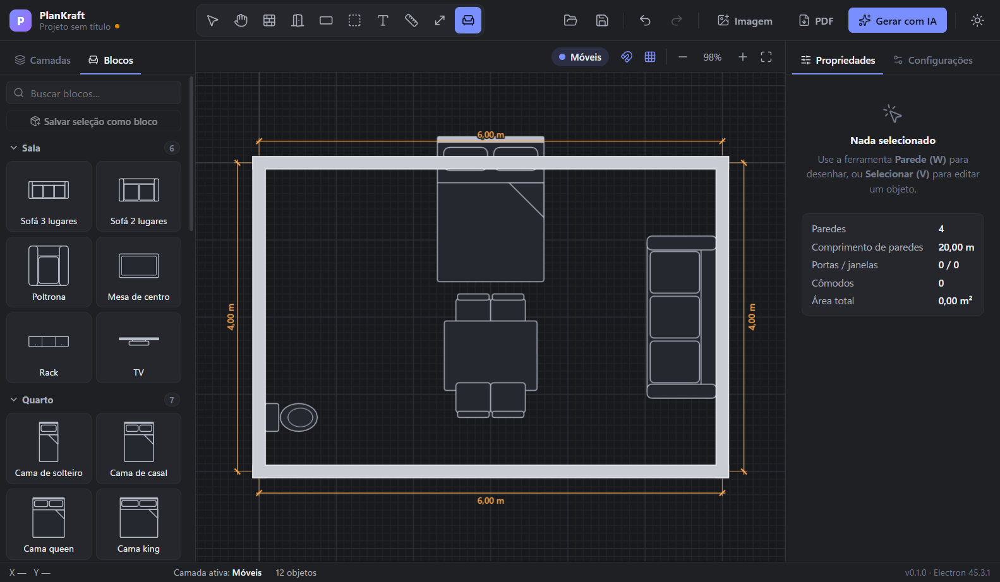 |
| **Camadas** — nomeadas, reordenáveis por arrastar, com visibilidade, bloqueio, opacidade e cor. | |
| **Gerar planta** — descreva "casa de 80 m² com 2 quartos e cozinha americana" e escolha entre 2–3 variações. Modo **offline** (gerador procedural, sem chave e sem custo) ou com **IA** (Claude ou OpenAI, chave criptografada). | 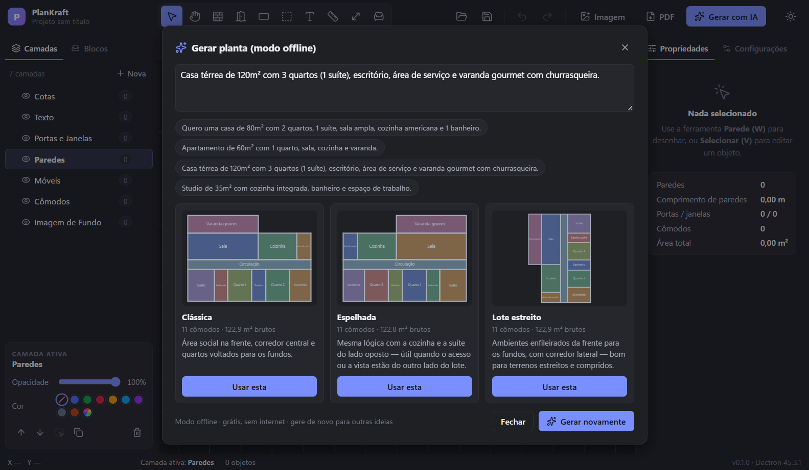 |
| **PDF vetorial** — A4, A3, A2 ou Carta, escala 1:50 / 1:100 / 1:200 ou ajustada, escolha de camadas, quadro de áreas e carimbo. | 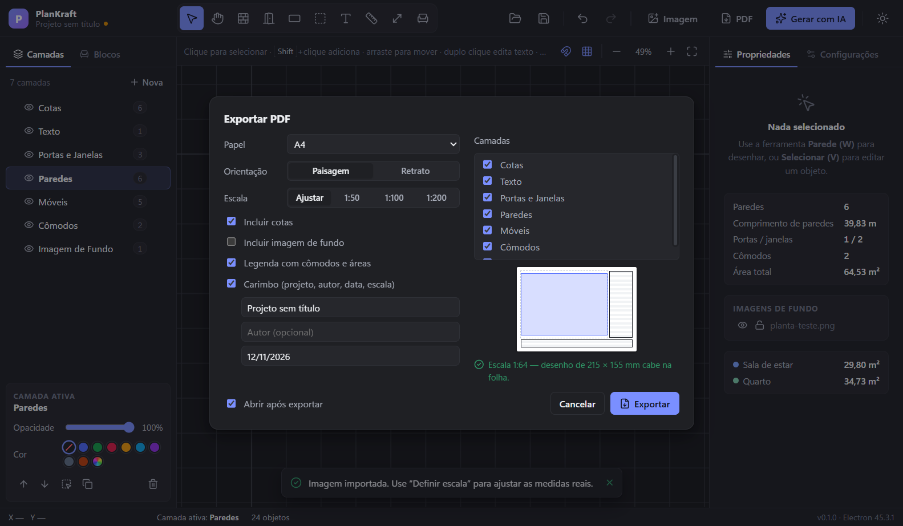 |
| **Maquete 3D** — paredes com vãos, portas, janelas, pisos e móveis em volume; câmera orbital, corte das paredes, sombras, **sol por hora do dia**, exportação em PNG de **2K/4K** e **panorama 360°** (equirretangular). | 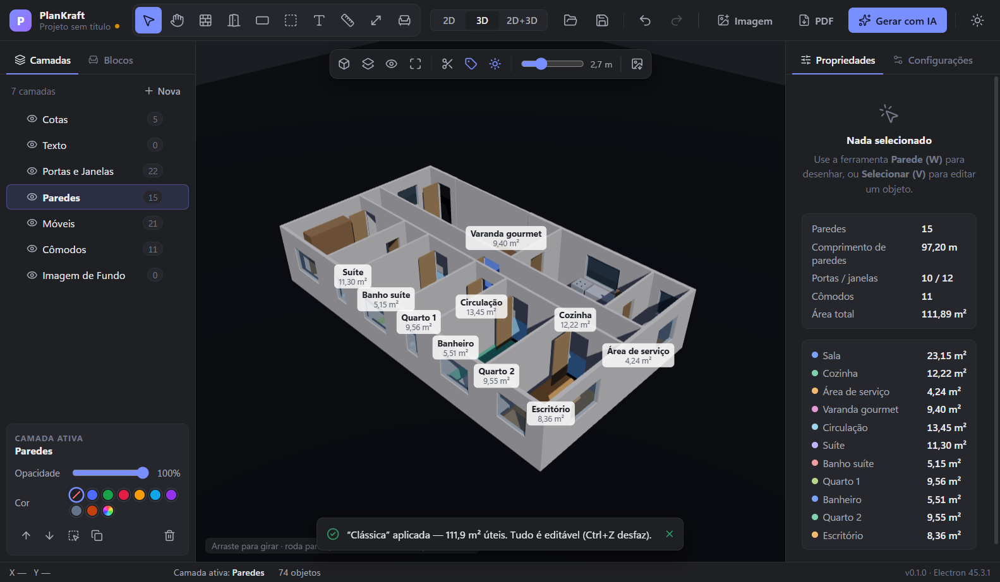 |
| **Área externa** — terreno com recuo e taxa de ocupação, gramado, deck, calçada e piscina (todos desenhados com a ferramenta Cômodo e o campo "Tipo de área"), muros e cercas com altura própria, árvores, arbustos, banco e carro. Tudo aparece no 2D, na maquete 3D e no PDF. | 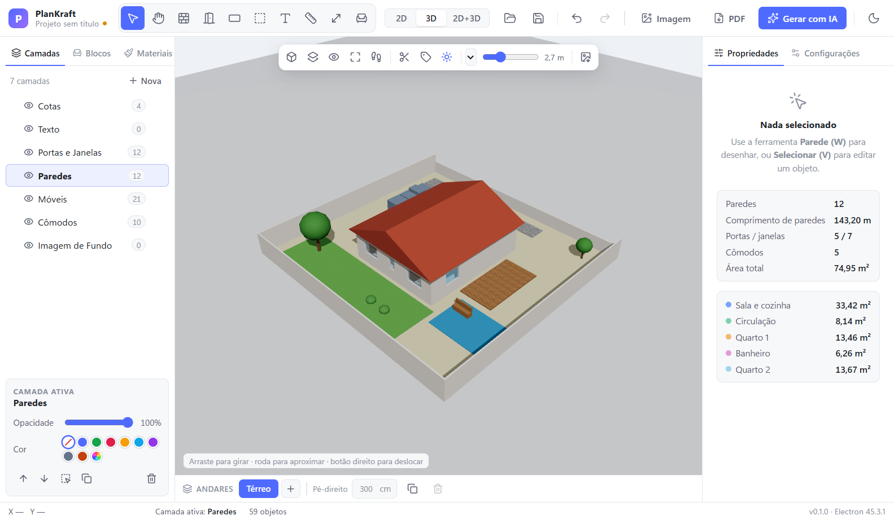 |
| **Detalhes arquitetônicos** — portas de abrir, duplas, de correr e vão livre; janelas de abrir, de correr, basculantes e fixas (com peitoril e altura); pilares quadrados e redondos; telhado plano, de duas ou de quatro águas na maquete 3D; **nichos** que recuam a parede, **rebaixos de gesso** no teto, **cerca de ripas** e **escadas retas, em L e em U** com largura, altura do degrau (espelho) e piso ajustáveis. Tudo aparece igual no 2D, no 3D e no PDF. | |
| **Reconhecer planta (IA)** — selecione a imagem de fundo e a IA com visão (Claude ou OpenAI) propõe cômodos, portas e janelas; você revisa sobre a imagem, escolhe a escala (da imagem ou a cota lida pela IA) e aplica numa única ação desfazível. | |
| **Panorama 360°** — gerado a partir do cômodo selecionado (ou de onde você está no passeio), com sol e sombras da hora escolhida. | 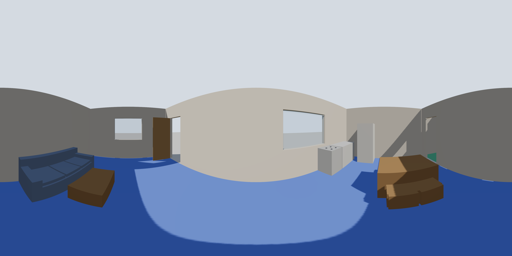 |
| **Passeio em primeira pessoa** — na vista 3D, caminhe pela casa na altura dos olhos (W A S D, Shift corre, arraste ou setas para olhar), com colisão nas paredes, portas atravessáveis e escadas que sobem de um andar para o outro. | |
| **Vários andares** — barra de andares (Térreo, 1º andar…) com pé-direito próprio, calco esmaecido do andar de baixo, duplicar andar, escada reta (furo na laje de cima) e PDF com uma folha por andar. | 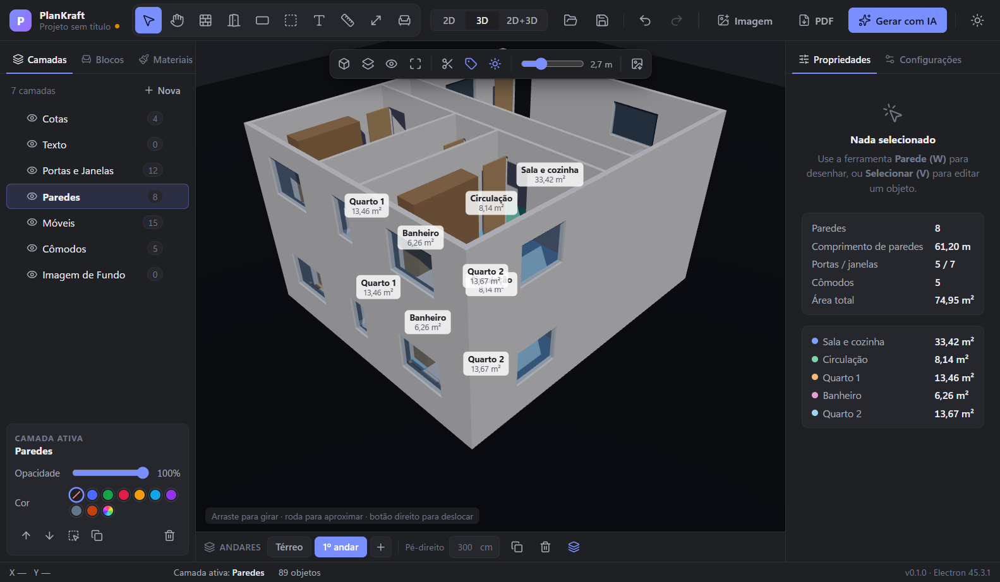 |
| **Materiais** — tintas, madeiras, porcelanatos, azulejos, pedras, tijolos e grama aplicados a pisos e paredes, em texturas geradas pelo próprio app (sem baixar nada); aparecem no 2D, na maquete 3D e no PDF (cor). | 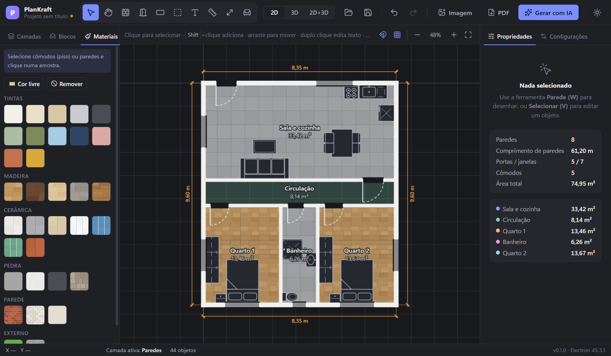 |
| **Imagem de fundo** — importe a foto/escaneamento de uma planta, ajuste a escala clicando em dois pontos de medida conhecida e trace por cima. | |

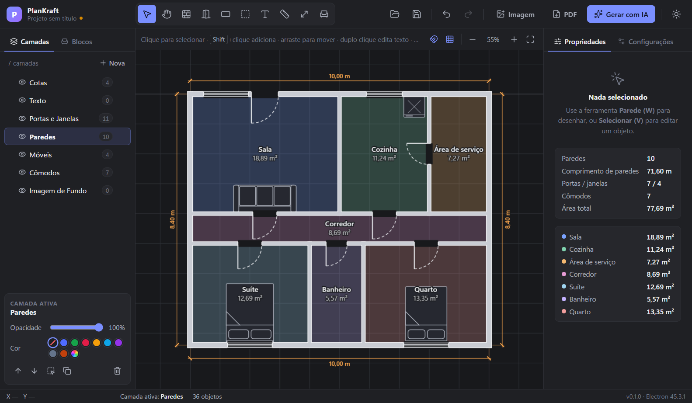

## Como rodar

Requisitos: **Node.js 20+** e npm.

```bash
npm install
npm run dev
```

| Comando | O que faz |
|---|---|
| `npm run dev` | Electron + Vite com hot reload |
| `npm run build` | Typecheck + build de produção em `out/` |
| `npm start` | Roda o build de produção |
| `npm run dist:win` | Gera o instalador Windows (electron-builder) |

Na primeira execução aparece um **tour de boas-vindas** (Ajuda → Tour de boas-vindas para rever).

## Atalhos principais

| Ação | Atalho |
|---|---|
| Selecionar · Mão · Parede · Porta · Janela · Cômodo · Texto · Medir · Cota · Blocos | `V` `H` `W` `D` `J` `C` `T` `M` `K` `B` |
| Travar 45° · desligar ímã | `Shift` · `Alt` |
| Girar bloco 90° | `R` (`Shift+R` = −90°) |
| Desfazer · Refazer | `Ctrl+Z` · `Ctrl+Y` |
| Copiar · Recortar · Colar · Duplicar | `Ctrl+C` · `Ctrl+X` · `Ctrl+V` · `Ctrl+D` |
| Novo · Abrir · Salvar · Salvar como | `Ctrl+N` · `Ctrl+O` · `Ctrl+S` · `Ctrl+Shift+S` |
| Importar imagem de fundo · mostrar/ocultar | `Ctrl+I` · `Ctrl+B` |
| Mostrar/ocultar cotas | `Ctrl+Shift+C` |
| Exportar PDF | `Ctrl+P` |
| Ajustar à tela · zoom | `Ctrl+0` · roda do mouse |

## Gerar planta: offline ou com IA

Em **Configurações → Inteligência artificial**:

- **Offline (grátis)** — padrão. Gerador procedural local: entende área, quartos, suítes (inclusive "3 quartos (1 suíte)"), banheiros,
  cozinha americana, varanda (gourmet), área de serviço, escritório, lavabo, garagem e studio. Instantâneo, sem internet;
  "Gerar novamente" rearranja os cômodos.
- **Claude** (`claude-opus-5-5`) ou **OpenAI** (`gpt-4o`) — layouts mais criativos com a sua chave de API. A chave é guardada com a
  criptografia do sistema operacional (`safeStorage`) e só o processo principal a usa; há um botão **Testar conexão**.

Em todos os modos o app recebe apenas os retângulos dos cômodos e monta o resto (paredes externas 15 cm / internas 10 cm, portas,
janelas, área útil, móveis encaixados e cotas), então o resultado é sempre geometricamente consistente e totalmente editável.

## Arquivos de projeto

- Projeto: `MeuProjeto.plankraft` (JSON legível).
- Imagens de fundo: pasta `assets/` ao lado do projeto (o JSON guarda só a referência). Se a imagem sumir, o projeto abre normalmente com um aviso.
- Blocos personalizados: biblioteca pessoal em `userData/block-library.json`; o projeto guarda uma cópia dos blocos que usa.

## Arquitetura

| Tema | Escolha | Por quê |
|---|---|---|
| App | **Electron + Vite (electron-vite) + React + TypeScript** | HMR, um build para main/preload/renderer |
| Canvas 2D | **Konva / react-konva** | Declarativo, hit-test por forma, Transformer para girar/redimensionar |
| Estado | **Zustand** | Store fora da árvore React; undo/redo por snapshots imutáveis |
| PDF | **jsPDF** a partir do **modelo** (não do canvas) | Vetorial de verdade, escala exata em mm |
| 3D | **three.js + @react-three/fiber + drei** | Gerado do mesmo modelo; carregado sob demanda |
| IA | **@anthropic-ai/sdk** / **openai**, saída estruturada validada com **Zod** | Chamadas só no processo main |

**Segurança do Electron:** `contextIsolation`, `sandbox`, sem `nodeIntegration`, CSP restritiva, navegação e janelas novas bloqueadas,
validação da origem em todo IPC, gravação só em caminhos escolhidos em diálogo nativo, chaves de API nunca expostas ao renderer.

```
src/
  main/        processo principal: janela, menu, IPC, arquivos, assets, PDF, IA, biblioteca
  preload/     ponte segura (contextBridge → window.api)
  shared/      modelo do documento, contrato IPC, serialização, schema da IA, gerador offline
  renderer/src/
    canvas/      palco Konva, paredes, aberturas, cômodos, cotas, blocos, imagens
    three/       cena e visualizador 3D
    pdf/         exportação PDF vetorial
    ai/          conversão da planta gerada em objetos do desenho
    components/  barra, painéis, diálogos, biblioteca, camadas
    store/       estado do editor, ações, camadas, blocos, imagens, arquivos
    lib/         geometria, formatação, cômodos (grafo planar), cotas, blocos
```

O que foi entregue em cada etapa do desenvolvimento está em [docs/ETAPAS.md](docs/ETAPAS.md).

## Autor

**Keny Shirata** — [@kenyshirata](https://github.com/kenyshirata)
